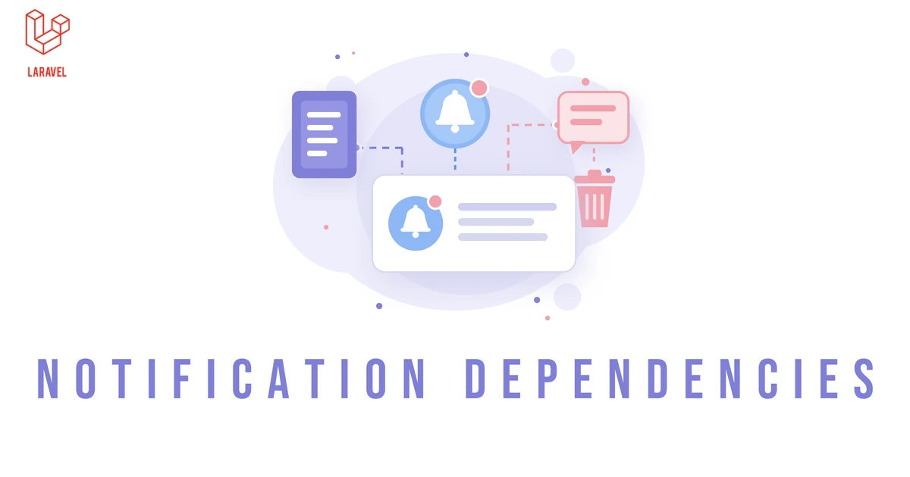

<p align="center"><a href="https://pharaonic.dev/packages/laravel/notification-dependencies" target="_blank"></a></p>

<p align="center">
  <a href="https://php.net" target="_blank"></a>
  <a href="https://laravel.com" target="_blank"></a>
  
  
  <br>
  <a href="https://packagist.org/packages/Pharaonic/laravel-notification-dependencies" target="_blank"></a>
  <a href="https://packagist.org/packages/pharaonic/laravel-notification-dependencies" target="_blank"></a>
  <a href="https://packagist.org/packages/pharaonic/laravel-notification-dependencies" target="_blank"></a>
</p>

<h3 align="center">Keep database notifications relevant: attach them to Eloquent models and delete them as soon as any of those models is deleted.</h3>
<br>

The `11.x` line supports Laravel 11 on PHP 8.2, 8.3 and 8.4.

## Installation

The package links rows of Laravel's own `notifications` table, so that table has to exist first:

```bash
# Only if the application has no notifications table yet:
php artisan notifications:table
php artisan migrate

composer require pharaonic/laravel-notification-dependencies:^11.0
php artisan migrate
```

The service provider is registered automatically, and `migrate` creates the `notification_dependencies` table. Publish the configuration when you need to change it:

```bash
php artisan vendor:publish --tag=notification-dependencies-config
```

## Usage

Add `HasDependentNotifications` to the models a notification can depend on, and `HasDependencies` to the notification. The notification is deleted as soon as any of its dependencies is deleted:

```php
use Pharaonic\Laravel\NotificationDependencies\Concerns\HasDependencies;
use Pharaonic\Laravel\NotificationDependencies\Concerns\HasDependentNotifications;

class Order extends Model
{
    use HasDependentNotifications;
}

class OrderCommented extends Notification
{
    use HasDependencies;

    public function via($notifiable)
    {
        return ['database'];
    }
}

$user->notify((new OrderCommented)->dependsOn($order, $comment));

$comment->delete(); // the notification is deleted too
```

## Documentation

Full documentation: [Laravel Notification Dependencies Documentation](https://pharaonic.dev/packages/laravel/notification-dependencies).

## Support & Security

See [SUPPORT.md](SUPPORT.md) and [SECURITY.md](SECURITY.md). Contributions are welcome; see [CONTRIBUTING.md](CONTRIBUTING.md).

## License

MIT. See [LICENSE](LICENSE).
